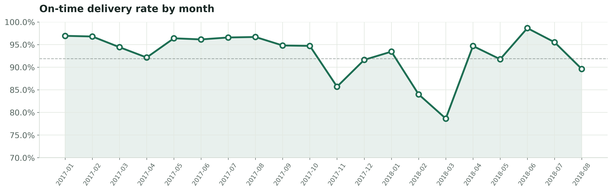

# Olist Delivery Performance & Customer Satisfaction

A business-analytics case study on 96,476 delivered orders from Olist, Brazil's largest e-commerce marketplace. Combines SQL analysis, Pandas pipelines, and an interactive HTML dashboard to answer five operational questions about delivery performance.

**⚠️ Simulated portfolio project.** No real client. All figures derived from the public [Brazilian E-Commerce Public Dataset by Olist](https://www.kaggle.com/datasets/olistbr/brazilian-ecommerce) (Kaggle).



---

## Business questions

1. What is the overall on-time delivery rate?
2. Which states / regions have the worst delivery performance?
3. Which product categories suffer the longest delivery times?
4. How much does a late delivery cost us in review score?
5. Which stage of the fulfillment pipeline causes the most delay?

## Headline findings

| # | Finding | Evidence |
|---|---|---|
| 1 | Overall on-time rate is **91.89%** (7,827 orders late out of 96,476 delivered). | SQL Query 1, reconciled in Pandas |
| 2 | On-time performance varies **~5×** by state. **AL 23.9%** late vs **PR 5.0%**. Northeast is systematically worse than South/Southeast. | SQL Query 2, min 200 orders per state |
| 3 | `office_furniture` takes **20.6 days** on average — nearly 2× the median category (12 days). All other categories are well-calibrated against estimates. | SQL Query 3, 43 categories, min 200 orders |
| 4 | Late deliveries average **2.57** review stars vs **4.30** on-time. 46% of late orders are 1-star vs 6.5% of on-time (**7× ratio**). | SQL Query 4, 95,302 reviewed orders |
| 5 | **Last-mile** accounts for 74% of delivery time (9.33 of 12.63 days). Handoff (2.86) and approval (0.43) are minor. | SQL Query 5, three stage averages |
| 6 | Three months show operational dips: **Nov 2017** (Black Friday), **Feb 2018**, **Mar 2018** (78.6%, worst month). | Monthly trend chart |

---

## Deliverables

| File | What it is |
|---|---|
| `notebooks/01_olist_delivery_analysis.ipynb` | Full pipeline (audit → clean → derive → SQL → charts) |
| `sql/01_schema.sql`, `02_checks.sql`, `03_kpis.sql` | SQL schema, quality checks, and KPI queries |
| `outputs/reports/olist_delivery_report.xlsx` | 6-sheet Excel workbook |
| `outputs/reports/olist_dashboard.html` | Interactive HTML dashboard |
| `outputs/figures/` | 5 chart PNGs (300 DPI) |
| `docs/DECISIONS.md` | Dictionary, KPIs, cleaning log, client answers, limitations |

---

## Method

**Pipeline:** Load → Audit → Client checkpoint → Clean → Derive fields → SQL handoff → SQL analysis → Reconcile → Charts → Document.

**Key decisions:**

- **Universe** = `order_status = 'delivered'` AND delivery date not null (96,476 orders).
- **Window** = Jan 2017 – Aug 2018 (early ramp-up and ragged tail excluded).
- **Customer identity** = `customer_unique_id`, not `customer_id` (which is regenerated per order).
- **Derived fields** computed once in Pandas (`delivery_days`, `lateness_days`, `is_late`, `approval_days`, `handoff_days`, `last_mile_days`).
- **Anomalies** flagged, not deleted: `sequence_anomaly` (738 rows), `sequence_anomaly_severe` (14), `impossible_delivery` (23), `migration_artifact` (71).
- **Review duplicates** resolved with a source-of-truth rule (1,128 rows quarantined to CSV).

**Sacred rules applied:**
- Raw data never edited.
- No silent fixes — every change in the cleaning log.
- Grain checked before every join.
- Every headline KPI computed twice (SQL + Pandas).
- Valid extremes kept; anomalies flagged.

---

## How to run

```bash
# 1. Install dependencies
pip install -r requirements.txt

# 2. Download the raw CSVs from Kaggle
#    https://www.kaggle.com/datasets/olistbr/brazilian-ecommerce
#    Place them in data/raw/

# 3. Open the notebook and run all cells top to bottom
#    Expected runtime: ~2 minutes
